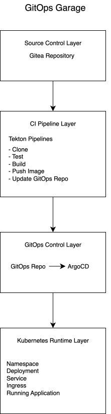

# GitOps Garage
## Open Source GitOps Delivery Platform for Kubernetes

Build once. Deploy everywhere.

GitOps Garage is an opinionated platform that helps development teams automate application delivery on Kubernetes using GitOps principles.

Designed for startups, software teams and platform engineers who want a reproducible CI/CD foundation built with Kubernetes-native tools.

## Table of Contents

- Introduction
- Why GitOps Garage?
- Architecture
- Workflow
- Features
- Repository Structure
- Technology Stack
- Project Status
- Roadmap
- Documentation
- Getting Started
- Contributing
- License

## Introduction

Modern software teams should focus on delivering software, not maintaining deployment scripts.

GitOps Garage provides a reusable delivery platform that automates the complete deployment lifecycle using Git as the single source of truth.

Instead of creating CI/CD pipelines from scratch for every project, this platform offers a production-oriented architecture that can be adapted to different Kubernetes environments.

## Why GitOps Garage?

Many startups and software teams still rely on manual deployments or ad-hoc automation.

This often leads to:

* Manual deployments
* Configuration drift
* Human errors
* Slow release cycles
* Limited rollback capabilities
* Difficult troubleshooting

GitOps Garage was created to provide a clean, reproducible and Kubernetes-native deployment workflow.

## Architecture

## Workflow

### Source Control Layer

Responsible for storing the application source code and triggering CI pipelines through Git webhooks.

### CI Pipeline Layer

Automates application build, testing, container image creation and GitOps repository updates using Tekton.

### GitOps Control Layer

Argo CD continuously monitors the GitOps repository and synchronizes the Kubernetes cluster with the desired state.

### Runtime Layer

Runs the application inside Kubernetes using declarative manifests managed through Helm.

## Features

Kubernetes-native deployment platform

GitOps-driven application delivery

Automated CI pipelines powered by Tekton

Continuous deployment with Argo CD

Helm-based application packaging

Multi-environment deployment strategy

Infrastructure and application versioning through Git

Reusable project templates

Production-oriented repository structure

Designed for startups and growing software teams

Open Source foundation with extensible architecture

## Repository Structure

### gitops-platform/

├── bootstrap/

├── diagrams/

├── docs/

├── examples/

├── platform/

├── scripts/

├── screenshots/

├── CHANGELOG.md

├── CONTRIBUTING.md

├── LICENSE

├── README.md

└── ROADMAP.md

## Technology Stack

| Category           | Technology          |
|--------------------|---------------------|
| Container Orchestration | Kubernetes       |
| GitOps             | Argo CD             |
| CI                 | Tekton Pipelines    |
| SCM                | Gitea               |
| Packaging          | Helm                |
| Container Images   | Docker              |
| Example Application| Spring Boot         |
| IaC (future)       | Terraform           |
| Automation         | Ansible             |

## Current Status

🚧 Status

GitOps Garage is currently under active development.

The first milestone focuses on building a reusable GitOps platform architecture before implementing CI/CD pipelines and deployment automation.

Current Version

v0.1.0-alpha

## Roadmap

[View the main ROADMAP](ROADMAP.md)

v0.1

Repository foundation

Documentation

Architecture

...

## Documentation

[Architecture](diagrams/architecture.svg)

[Design Principles](docs/design-principles.md)

Installation Guide

Workflow

Operations Guide

Troubleshooting

## Getting Started

 🚧 comming soon! 🚧 

## Contributing

Thank you for your interest in contributing to GitOps Garage!

We welcome contributions that improve the platform, documentation or examples.

[View the entire CONTRIBUTING.md](CONTRIBUTING.md)

## License

MIT License

Copyright (c) 2026 gitops-garage

[LICENSE](LICENSE.md)